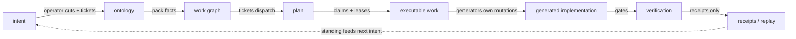

# Chatman Ecosystem Map

**As of 2026-09-21.** Grounded in the 8-agent read-only survey digest (2026-09-21 ~19:33Z, inspection-only) plus direct verification of this repo and GitHub metadata in the session that wrote this file. Evidence discipline: `inspection ≠ execution` — standing labels reflect what was *observed*, not assumed. Vocabulary: `ALIVE | PARTIAL_ALIVE | UNKNOWN | BLOCKED`. `ALIVE` claims below are the survey's, made on same-day observed receipts; this file's author personally verified only what is marked in [Provenance](#provenance).

---

## 1. Components

| Component | Responsibility | Local repo / asset | Standing as of 2026-09-21 |
|---|---|---|---|
| **sJira** | Semantic work graph — tickets as `oslc_cm:ChangeRequest` dual-typed `earl:TestRequirement`; entire session history lives in `docs/jira/` trees, not conversation | `~/ash_surface/docs/jira/` (v26.9.16, v26.9.17, v26.9.19 trees confirmed present); trees also in `~/ggen_igniter`, `~/ggen` | PARTIAL_ALIVE — `ash_surface` on `feat/dfcm-surface-core` @386135c (09-17); 5 OPEN v26.9.19 operator-decision tickets; ticket 050 BLOCKED; 31 fleet worktrees |
| **SA2A** | Capability coordination between agents/services | `~/ash_a2a` + `packs/sa2a-bridge-pack` (v26.9.20) in `~/ggen-marketplace` | PARTIAL_ALIVE — `ash_a2a` main @2730c9b4 (09-21); v26.9.18–v26.9.20 releases merged; 4 unpushed commits, 2 dirty files (mid-flight release edit), Chicago falsifier artifacts 12:33 (active WIP), 5 unmerged branches |
| **AutoFDE Lab** | Full-development-experience lab (role not re-confirmed) | `~/autofde-lab` (directory exists; not re-surveyed) | UNKNOWN |
| **ggen-marketplace** | Prior art catalog: packs (`pack.toml` → `ontology.ttl` → `templates/` → `gates/`), admission path for new capability | `~/ggen-marketplace` — 319 packs (re-counted this session: 319) | PARTIAL_ALIVE — main @5646c7932 (09-20); diverged ahead 3 / behind 4; WIP in `~/wt` worktrees |
| **ash_kudzu** | Schema→ontology reconstruction | `~/ash_kudzu` — directory exists locally but was not surveyed; contents unverified | UNKNOWN / not found in survey (presence-only check this session) |
| **ggen_igniter** | Manufacture: generators own mutations; pack/ticket scaffolding via `mix ggen_igniter.sync` and `Igniter.compose_task/4` | `~/ggen_igniter` | ALIVE — `feat/zcode-ocel-pack` @dcebc42 (09-21) clean; calver-ticket-day-pack folded + 6 merges; receipts emitted 12:25 |
| **XaaS** | Execution plane: leased workers, epochs, claims, brokered authority, receipt-bearing closure | `~/xaas` | PARTIAL_ALIVE — main @4b79f11 (09-21); crown branches ALL MERGED; ahead origin 252 unpushed; 1 dirty test file (active WIP); Crown v1+v2 KNOWN_REPLAY sha256:9471200b…; OCEL 15/15 |
| **zcode-cli** | Worker protocol / agent CLI harness | `~/dev/zcode-cli` | ALIVE — commits today via `~/wt` worktrees |
| **UltraCode** | Bounded transformation inside `ultracode` branches of XaaS (probe artifacts at `~/xaas/tmp_out/ultracode_probe_*.ex`, docs at `~/xaas/docs/ultracode`) | Inside `~/xaas` (no separate repo) | UNKNOWN as a component — artifacts documented; no execution witnessed this survey |
| **Verification courts** | Scattered gates: pytest suites, `scripts/validate_sigma.sh` (this repo), `mix` gates in ash/ggen repos, APS `tools/verify.py`, OCEL checks, Crown replay verification | `~/chatman-ecosystem` (pytest 28/28 at merge per merge receipt; sibling re-run in flight today), `~/ash_surface`, `~/ggen-marketplace`, APS tree | PARTIAL_ALIVE — APS clean @5c31d9d; gates exist and are invoked by survey receipts; no single owner; full cross-court re-run pending |
| **Receipts / replay** | Evidence plane: append-only run ledgers, guard runs, capacity telemetry, ggen reconciliation receipts | `~/dfcm-autonomous/RUNS.md` (3.3 MB, mtime today 12:52; guard run 5357 today), `~/.zcode/workspace/default/capacity-ride/log.ndjson` (last write 09-17), ggen receipts jsonl (12:25) | ALIVE for RUNS.md + ggen receipts; capacity-ride log dormant since rider stopped 09-17 18:24Z |

### Supporting assets observed (not separate components)

| Asset | Role | Standing as of 2026-09-21 |
|---|---|---|
| `~/ggen` (Rust workspace) | ggen core engine | PARTIAL_ALIVE — `fix/ggen-v26.9.17-boundary` @5cc8808c1 (09-17), idle |
| `~/zoela_phx` | Consumer app (産面) | UNKNOWN — `exp/substrate-receipt-digest-reconcile` @71a5fe2 (09-20); no remote; `erl_crash.dump` present |
| `~/dfcm-autonomous` | Guard loop emitting RUNS.md | ALIVE — main @9229ae0; guard run 5357 today |
| `~/ferroplan` | Planner | PARTIAL_ALIVE — main @e90928d (09-18), idle 3 days |
| `~/.zcode/workspace/default` | Rider / capacity automation home | UNKNOWN/dormant — rider STOPPED 09-17 18:24Z |

---

## 2. The two lineages of the name

There are **two unrelated repositories both called `chatman-ecosystem`**. Do not conflate them.

**Local lineage — `~/chatman-ecosystem` (this repo).**
- `main` @7ac66d8 (2026-09-19 23:13 −0700), clean tree; branches: `main`, `exp/pr3-jurisdiction-refusal-contracts`.
- **No remote configured** (`git remote -v` empty) — **never pushed**; unreachable from GitHub.
- Contents: `census/2026-jurisdiction-census.md` (PR-1 @6674a3d, 09-12: jurisdiction census across 14 named repos); `packs/scm-sigma-pack/` (pack.toml, ontology.ttl, shapes.ttl, sigma.schema.json, template generator); Python `prototype/` (composition, jurisdiction, verifier, compound, demo; 3 test files — pytest 28/28 at the 7ac66d8 merge per merge receipt); `scripts/validate_sigma.sh`.
- History: census (PR-1) → SCM vertical slice @8058056 → cross-repo pattern port @c0289685 → jurisdiction refusal contracts (PR-3, @7ac66d8).

**GitHub lineage — `seanchatmangpt/chatman-ecosystem`.**
- ggen Rust workspace + praxis-graphlaw SHACL work; `main` @c59596f (09-11).
- Still active: repo `pushed_at` **2026-09-21T03:43:17Z** (verified via `gh api` this session — matches the accomplishment-log branch pushes); ~250 PRs historically; 2 open PRs at check time (survey brief: #250 and #251); 23 open issues.
- This local machine has no clone-link to it.

**Conceptual bridge, not genealogical.** This repo's commit @c0289685bc2a4c761e2bd41933df0abf388acca8 ("Prototype: port 3 real cross-repo patterns (praxis-graphlaw, mfw) into the verifier/compound", 09-12) ports patterns from praxis-graphlaw — the same repo where the 09-11 GitHub line did its SHACL work. Related ideas, disjoint histories: the local repo's ancestry contains no commit from the GitHub repo, and no remote/fetch path connects them.

---

## 3. Data flow: whitepaper pipeline → today's repos

| Stage | Played locally today by |
|---|---|
| **intent** | Operator ontology edits + authority cuts; ticket files in `~/ash_surface/docs/jira/` (sJira); `~/dfcm-autonomous` guard runs (5357 today) |
| **ontology** | `~/ggen-marketplace` packs (319; source hierarchy `marketplace.toml → pack.toml → ontology.ttl → templates/ → gates/`); `~/chatman-ecosystem/packs/scm-sigma-pack/` (local prototype pack) |
| **work graph** | sJira `docs/jira/` trees in `~/ash_surface`, `~/ggen_igniter`, `~/ggen` — append-only ticket History is the session record |
| **plan** | `~/ferroplan` (idle 3 days); rider setpoint automation (workspace, STOPPED 09-17) — planning capacity currently thinnest link |
| **executable work** | `~/xaas` leased epochs (`claim_next → heartbeat → close_candidate`); `~/dev/zcode-cli` worker protocol; UltraCode branches for bounded transformation |
| **generated implementation** | `~/ggen_igniter` (Igniter compose tasks, migrations, snapshots); marketplace templates rendered into consumer trees (e.g. `~/zoela_phx`) |
| **verification** | Verification courts: pytest (incl. this repo's `prototype/tests/` + `scripts/validate_sigma.sh`), `mix` gates, APS `tools/verify.py`, OCEL 15/15, Crown KNOWN_REPLAY sha256:9471200b… |
| **receipts** | `~/dfcm-autonomous/RUNS.md`, capacity-ride `log.ndjson`, ggen receipts jsonl (12:25 today), HANDWRITTEN.md ledgers + reconciliation manifests per repo |

---

## 4. What this map does NOT cover

Inspection debt — directories that exist locally but were **not re-surveyed on 2026-09-21** (presence checks only, where noted):

- **`~/autofde-lab`** — exists; role and standing UNKNOWN (not re-surveyed).
- **`~/ash_kudzu`** — directory exists (presence check this session, contradicting "no local repo" in earlier notes); contents, branch, and standing UNKNOWN. Schema→ontology reconstruction role taken from the survey brief.
- **`~/ash_r2rml`** — exists; not surveyed.
- **`~/beam4pm`** — exists; not surveyed.
- **`~/zoela_phx`** — last digest entry 09-20 (UNKNOWN, crash dump present); not re-surveyed 09-21.
- **GitHub lineage internals** — verified via metadata API only (pushed_at, open counts); no clone or fetch; PR numbers #250/#251 and branch details from the survey brief.
- **pytest re-run** — 28/28 figure is the 09-19 merge receipt's, not re-executed by this file's author (a sibling agent was re-running it today; result not yet in).

---

## Provenance

Written 2026-09-21 by one of an 8-agent documentation fleet; this file is hand-authored (documentation, no admitted pack currently renders ecosystem maps — candidate future generator: map rendered from RUNS.md + ggen receipts). Verified this session, read-only: this repo's `git log`/`status`/`remote`/`branch`/`show` (with `--no-optional-locks`); `gh api` repo metadata for the GitHub lineage; existence checks for all listed directories; marketplace pack count (319); mtimes of RUNS.md and log.ndjson. Everything else is the 2026-09-21 ~19:33Z survey digest, cited as reported. No git state was changed anywhere; the tree stays uncommitted for operator review.
